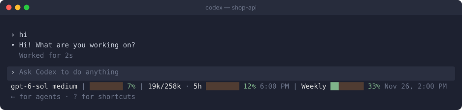

# termbar

A status line for AI coding CLIs. Shows the model, context-window usage and
rate limits as colored progress bars. Works with **Claude Code** and **OpenAI
Codex CLI**, and new CLIs plug in as small adapters.




The lines and their order are configurable (see [Configuration](#configuration)).

Bars are green below 70%, orange from 70%, red from 90%. A `~` before a percentage
means the number is an estimate from local logs, not a value the CLI reported.

> Status: early (v0.1). Not published to npm yet.

## Install

```sh
curl -fsSL https://raw.githubusercontent.com/<you>/termbar/main/install.sh | sh
```

or manually (Node >= 22.18):

```sh
npm install -g termbar        # or: npm install -g github:<you>/termbar
termbar install --dry-run     # preview
termbar install               # Claude Code + Codex
termbar doctor
```

`termbar install` never overwrites an existing Claude `statusLine` on its own. Choose how to proceed:

| Flag | Effect |
|---|---|
| `--wrap` | Keep your current command in front and let termbar draw the line. Tools that read Claude's stdin (such as AFK Pug) keep working. |
| `--force` | Replace the current command with termbar. |
| `--dry-run` | Show the change without writing anything. |

How `--wrap` works: for the AFK Pug form (`if [ -x '…/afkpug-statusline' ]; then '…/afkpug-statusline' '<cmd>'; …`), only `<cmd>` is swapped for `termbar render`, so AFK Pug stays in front. For any other command, termbar runs it with a copy of stdin, discards its output, then runs `termbar render` with the same stdin.

`termbar uninstall --claude` restores the exact previous command (or deletes the `statusLine` if there was none). Both install and uninstall first save `settings.json.termbar-backup-<timestamp>` next to `settings.json`.

```sh
termbar install --claude --wrap --dry-run   # preview
termbar install --claude --wrap
termbar uninstall --claude
```

## How it hooks in

| CLI | Mechanism | Data source |
|---|---|---|
| Claude Code | `statusLine.command` in `~/.claude/settings.json` runs `termbar render --provider claude` | JSON on stdin (`model`, `context_window`, `rate_limits`) |
| Codex CLI | Native **custom status line provider**: termbar runs as an MCP stdio server (`termbar mcp`) registered with `codex mcp add` | State Codex passes to the provider (model, context, rate limits) |
| Anything else | `termbar watch --provider <id>` in a tmux pane or second terminal | The adapter's own source |

### Codex setup

```sh
codex mcp add termbar -- node "$(npm root -g)/termbar/dist/cli.js" mcp   # `termbar install --codex` does this
```

Then in Codex: enable **Custom status line** in `/experimental`, restart, open
`/statusline`, choose **Choose a status line provider**, and pick termbar. The
provider API is experimental and may change between Codex versions. Codex
polls the provider about once per second and stops if a read errors or times out.

Without the native provider, `termbar watch --provider codex` reads the newest
session log under `~/.codex/sessions`. Limits only appear there when the log
contains them; termbar does not invent numbers.

### Claude usage API (opt-in)

By default termbar uses only the `rate_limits` Claude Code sends on stdin. If you want
usage from Anthropic's OAuth usage endpoint when stdin has none, enable it
explicitly, via `~/.config/termbar/config.json`:

```json
{ "claude": { "oauthUsage": true } }
```

or `TERMBAR_CLAUDE_OAUTH=1`, or `--oauth-usage`. This reads your Claude Code token
(env var or macOS Keychain) and calls `api.anthropic.com` with a 60 s cache. The
endpoint is undocumented and may change.

## Configuration

Create a starter file and preview it:

```sh
termbar config init     # writes ~/.config/termbar/config.json
termbar items           # list the widgets you can use
termbar preview         # show your layout with sample data
```

```json
{
  "lines": [
    ["model", "context", "tokens"],
    ["limit-5h", "limit-weekly"]
  ],
  "providers": {
    "codex": { "lines": [["model", "context"], ["limits"]] }
  },
  "separator": "|",
  "barWidth": 10,
  "showResets": true,
  "claude": { "oauthUsage": false }
}
```

- `lines`: one array per line, top to bottom, at most 4 lines and 12 widgets each. Order is up to you. Widgets with no data (for example limits the CLI doesn't report) are skipped, and empty lines disappear.
- `providers.<name>.lines`: a different layout per CLI (`claude`, `codex`).
- Widgets: `model`, `provider`, `context`, `tokens`, `remaining`, `limit-5h`, `limit-weekly`, `limits`, `cwd`, and `text:<words>` for literal text.
- `separator`: up to 3 characters between widgets; `""` means a single space.
- `showResets`: show reset times after limit bars.
- Codex shows everything on **one row**: its footer has no line breaks and rejects `\n`, so termbar joins your lines with `·`. Claude Code shows each line separately.
- Unknown widgets and bad values fall back to defaults; `termbar doctor` lists the problems.

The Codex provider re-reads the config on every poll, so edits show up within about a second. Claude Code reads it on its next status line refresh.

Environment: `NO_COLOR` (disable color), `TERMBAR_COLOR=0`, `COLUMNS` / `--columns N` (width budget).

## Layout and resizing

termbar prints plain text; the CLI positions it. When a width is known it shrinks the
bar (10 → 5 → none), then drops widgets from the end of a line and finally truncates with `…`, so lines never wrap. Without
`COLUMNS`/`--columns` (Claude Code runs the command without a TTY) it assumes enough width.

## Privacy and security

- Reads Codex's `sessions/` logs and the `model` line of `config.toml` only. It never opens Codex's credentials file (a test enforces this).
- No network access unless you opt in to the Claude usage API.
- No telemetry.

## Architecture

```
adapters/*  →  Snapshot  →  core/layout  →  render/ansi        (Claude Code, watch)
(per CLI)      (neutral)    (bars, fit)     render/codexTree    (Codex footer)
```

See [docs/ADDING_AN_ADAPTER.md](docs/ADDING_AN_ADAPTER.md).

## Website

`site/` is a static page (no build step) with a Thai/English toggle (`?lang=th` / `?lang=en`).
Open `site/index.html` in a browser, or publish the folder with GitHub Pages.
The screenshots in `site/assets/` are generated from real layout code:

```sh
npm run images
```

## Development

```sh
npm install
npm run typecheck
npm test
npm run build
```

## License

MIT
