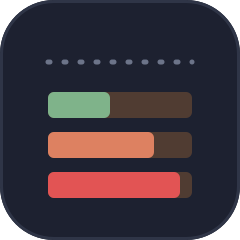
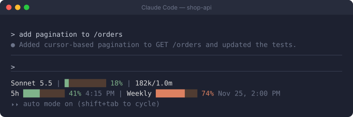
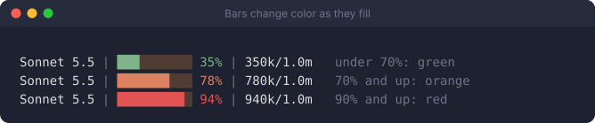
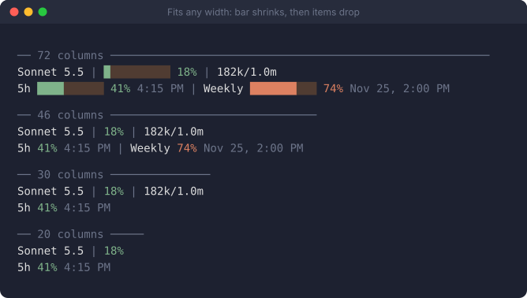
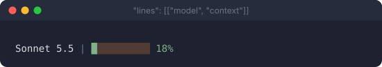
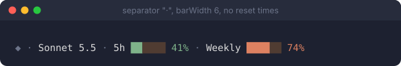
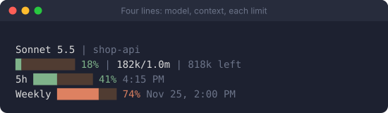

<p align="center">
  
</p>

<h1 align="center">AI Headroom</h1>

<p align="center">
  <b>Know how much room your AI has left, right at the bottom of the terminal.</b>
</p>

<p align="center">
  
  
  
  
  
  
</p>

<p align="center">
  <a href="#what-it-does">What it does</a> ·
  <a href="#installation-guide">Installation guide</a> ·
  <a href="#what-youll-see">What you'll see</a> ·
  <a href="#make-it-yours">Make it yours</a> ·
  <a href="#privacy">Privacy</a> ·
  <a href="#troubleshooting">Troubleshooting</a> ·
  <a href="README.th.md">ภาษาไทย</a>
</p>

<p align="center">
  
  <br>
  <sub>Made from the tool's real layout code · sample data</sub>
</p>

---

## What it does

You're deep in a refactor with Claude Code or Codex. The answers get vaguer, then the agent stops: the context window is full, or you hit your 5-hour limit. You had no idea it was close.

**AI Headroom puts the numbers you keep checking into the status line of your AI CLI**, updated as you work, so you see the wall before you hit it.

- **Model and context:** the model you're on, a bar for the context window and token counts like `182k/1.0m`
- **Usage limits:** your 5-hour and weekly quota with the time each one resets
- **Color by level:** green below 70%, orange from 70%, red from 90%
- **Your layout:** choose what goes on each line and in what order, separately for Claude and Codex
- **Fits any width:** bars shrink first, then items drop, so the line never wraps into a mess
- **Plays nice with others:** `--wrap` keeps your existing status line (for example [AFK Pug](https://github.com/Pug-03/AFK_Pug)) working, and uninstall puts it back exactly
- **No made-up numbers:** if a CLI doesn't report a limit, AI Headroom shows nothing rather than guessing
- **Stays on your machine:** no account, no telemetry, no network unless you opt in

| Works with | How it connects | Lines |
|---|---|---|
| **Claude Code** | `statusLine` command in `~/.claude/settings.json` | as many as you like |
| **OpenAI Codex CLI** | Codex's own status line provider (MCP) | one row ([why](#why-is-codex-only-one-row)) |
| **Anything else** | `aiheadroom watch` in a tmux pane or spare tab | as many as you like |

---

## Installation guide

It takes about two minutes. Most people need **Before you start**, **A**, and **B** or **C**.

| Part | What it covers | Who needs it |
|---|---|---|
| [Before you start](#before-you-start) | Node.js | everyone |
| [A. Install the command](#a-install-the-command) | one line in Terminal | everyone |
| [B. Claude Code](#b-claude-code) | turn on the status line | Claude Code users |
| [C. Codex CLI](#c-codex-cli) | register and pick the provider | Codex users |
| [D. Other CLIs and tmux](#d-other-clis-and-tmux) | a live panel next to your agent | optional |
| [Update or uninstall](#update-or-uninstall) | newer versions, removing it | later |

### Before you start

You need **Node.js 22.18 or newer**. Check in Terminal:

```sh
node --version
```

If it's older or missing, install it from [nodejs.org](https://nodejs.org) or with `brew install node`.

### A. Install the command

```sh
npm install -g github:Pug-03/AI-Headroom
aiheadroom doctor
```

`doctor` checks Node, finds Claude Code and Codex, and points out problems in your settings.

<details>
<summary><b>Prefer the one-line installer, or building from source?</b></summary>
<br>

The installer does A and B for you:

```sh
curl -fsSL https://raw.githubusercontent.com/Pug-03/AI-Headroom/main/install.sh | sh
```

From source:

```sh
git clone https://github.com/Pug-03/AI-Headroom.git
cd AI-Headroom
npm install        # also builds
npm link           # makes `aiheadroom` available everywhere
```

</details>

### B. Claude Code

**B1. Preview the change.** Nothing is written yet:

```sh
aiheadroom install --claude --wrap --dry-run
```

**B2. Install.**

```sh
aiheadroom install --claude --wrap
```

| Flag | What happens to your current status line |
|---|---|
| `--wrap` | **kept in front.** It still gets Claude's data (AFK Pug keeps tracking your limits), and AI Headroom draws the line |
| `--force` | replaced by AI Headroom |
| neither | nothing changes if you already have one; you're asked to choose |

Both back up `settings.json` first, as `settings.json.aiheadroom-backup-<time>`.

**B3. Restart Claude Code.** The new line appears under the prompt.

### C. Codex CLI

**C1. Register AI Headroom with Codex.**

```sh
aiheadroom install --codex
```

This runs `codex mcp add aiheadroom …` for you.

**C2. Turn on custom status lines.** Open `codex`, type `/experimental`, check **Custom status line** with <kbd>space</kbd>, press <kbd>enter</kbd>, then quit and open Codex again.

**C3. Pick the provider.** Send any message, then type `/statusline` → **Choose a status line provider** → **AI Headroom**.

You only do this once: Codex remembers your choice.

> [!NOTE]
> Codex's status line provider is still an experimental Codex feature. If the footer ever falls back to the default, see [The Codex footer went back to normal](#the-codex-footer-went-back-to-normal).

### D. Other CLIs and tmux

If a CLI has nowhere to put a status line, run AI Headroom next to it. It redraws every 2 seconds from Codex's local session logs:

```sh
aiheadroom watch --provider codex
```

Numbers that come from logs rather than the CLI itself are marked with `~`.

### Update or uninstall

| To | Run |
|---|---|
| **Update** | `npm install -g github:Pug-03/AI-Headroom` again, then restart your CLI |
| **Remove from Claude Code and Codex** | `aiheadroom uninstall` (restores your previous Claude status line) |
| **Remove the command** | `npm uninstall -g aiheadroom` |

---

## What you'll see

### Claude Code

<p align="center">
  
</p>

Two lines by default: **model · context bar · tokens** on top, **5-hour and weekly limits with reset times** below.

### Codex CLI

<p align="center">
  
</p>

The same information in Codex's footer, on one row.

### The colors

<p align="center">
  
</p>

| Color | When | What to do |
|---|---|---|
| 🟩 green | under 70% | carry on |
| 🟧 orange | 70% and up | wrap up the task, or start a fresh session soon |
| 🟥 red | 90% and up | the agent may stop or compact any moment |

### Narrow terminals

<p align="center">
  
</p>

When the window gets narrow, bars shrink first, then items drop from the end of the line.

---

## Make it yours

Create a settings file, see what you can add, and preview it with sample data:

```sh
aiheadroom config init     # writes ~/.config/aiheadroom/config.json
aiheadroom items           # lists everything you can show
aiheadroom preview         # Claude layout
aiheadroom preview --provider codex
```

Each `[ … ]` in `lines` is one line, top to bottom. Items go left to right.

```json
{
  "lines": [
    ["model", "context", "tokens"],
    ["limit-5h", "limit-weekly"]
  ],
  "providers": {
    "codex": {
      "lines": [["model", "context", "tokens", "limit-5h", "limit-weekly"]],
      "separator": "·",
      "barWidth": 6,
      "showResets": false
    }
  }
}
```

Codex picks up changes within about a second. Claude Code shows them on its next refresh.

<table>
<tr>
<td width="50%"><br><b>Minimal</b><br><code>[["model", "context"]]</code></td>
<td width="50%"><br><b>Compact</b><br><code>"separator": "·", "barWidth": 6, "showResets": false</code></td>
</tr>
<tr>
<td colspan="2"><br><b>Detailed</b><br><code>[["model", "cwd"], ["context", "tokens", "remaining"], ["limit-5h"], ["limit-weekly"]]</code></td>
</tr>
</table>

### What you can show

| Item | Shows | Example |
|---|---|---|
| `model` | model name | `Sonnet 5.5` |
| `context` | context bar and percent | `███░░░░░░░ 18%` |
| `tokens` | tokens used / window | `182k/1.0m` |
| `remaining` | tokens left | `818k left` |
| `limit-5h` | 5-hour limit and reset time | `5h ████░░ 41% 4:15 PM` |
| `limit-weekly` | weekly limit and reset time | `Weekly ███████░ 74% Nov 25` |
| `limits` | every limit the CLI reports | |
| `cwd` | folder name | `shop-api` |
| `provider` | which CLI | `claude` |
| `text:…` | your own text | `text:🐶` |

### Settings

| Setting | What it does | Default |
|---|---|---|
| `lines` | what each line shows, up to 4 lines of 12 items | model, context, tokens / 5h, weekly |
| `separator` | between items, up to 3 characters; `""` for a space | `\|` |
| `barWidth` | bar length, 0–40 (0 hides bars) | `10` |
| `showResets` | reset times after limit bars | `true` |
| `providers.claude` / `providers.codex` | any of the above, for one CLI only | |
| `claude.oauthUsage` | fetch Claude limits from the usage API when Claude doesn't send them ([details](#privacy)) | `false` |

| Environment | Effect |
|---|---|
| `NO_COLOR=1` | plain text, no colors |
| `COLUMNS=80` or `--columns 80` | width to fit into |
| `AIHEADROOM_CLAUDE_OAUTH=1` or `--oauth-usage` | same as `claude.oauthUsage` |

A wrong value doesn't break anything: AI Headroom uses the default and `aiheadroom doctor` tells you what to fix.

---

## Privacy

- **No telemetry, no account.**
- **No network by default.** Claude Code and Codex hand their data to AI Headroom directly.
- **The Claude usage API is opt-in.** With `claude.oauthUsage` on, and only when Claude sends no limits, AI Headroom reads the token Claude Code already stored (environment variable or macOS Keychain) and asks `api.anthropic.com` for your usage, at most once a minute. This endpoint isn't officially documented and may change.
- **Codex:** it reads only `~/.codex/sessions/` and the `model` line of `~/.codex/config.toml`. It never opens Codex's login file; a test checks the source for this.
- **Your settings are backed up** before any change, and `aiheadroom uninstall` restores them.

---

## Troubleshooting

### The Codex footer went back to normal

Codex stops asking a provider after one failed read and shows its default footer. Press <kbd>F2</kbd> to see why, then type `/statusline` → **Choose a status line provider** → **AI Headroom** to start it again. After updating AI Headroom, restart Codex so it loads the new version.

### Why is Codex only one row?

Codex's footer has no line break, and it rejects control characters like `\n`. AI Headroom joins your lines with `·` instead, and Codex wraps the row if it's wider than the window. For several lines, use Claude Code or `aiheadroom watch`.

<details>
<summary><b>I don't see my limits</b></summary>
<br>

AI Headroom only shows limits the CLI reports. They're missing when you're logged out, when your plan has no limits, or in Codex before the first reply of a session. For Claude, you can opt in to the usage API: `"claude": { "oauthUsage": true }`.

</details>

<details>
<summary><b>Claude Code still shows my old status line</b></summary>
<br>

Restart Claude Code. Then check what's set:

```sh
aiheadroom doctor
grep -A3 statusLine ~/.claude/settings.json
```

If another app rewrote `statusLine`, run `aiheadroom install --claude --wrap` again.

</details>

<details>
<summary><b><code>aiheadroom: command not found</code></b></summary>
<br>

npm's global folder isn't on your `PATH`. Find it with `npm prefix -g` and add its `bin` folder to `PATH`, then open a new Terminal window.

</details>

<details>
<summary><b>Codex doesn't list AI Headroom as a provider</b></summary>
<br>

Check that it's registered with `codex mcp list`, that **Custom status line** is on in `/experimental`, and that you've sent at least one message in this Codex session. The provider connects when a conversation starts.

</details>

---

## For developers

```
adapters/*  →  Snapshot  →  core/layout  →  render/ansi        (Claude Code, watch)
(one per CLI)  (neutral)    (bars, fit)     render/codexTree    (Codex footer)
```

Each CLI has an adapter that turns its data into one neutral `Snapshot`. Layout and drawing never see anything CLI-specific, so supporting a new CLI is one file. See [Adding an adapter](docs/ADDING_AN_ADAPTER.md).

```sh
npm install
npm run typecheck
npm test
npm run images     # regenerate the screenshots in site/assets
```

`site/` is a static page with a Thai/English toggle. Open `site/index.html`, or publish it with GitHub Pages.

## License

MIT
