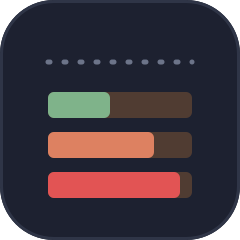
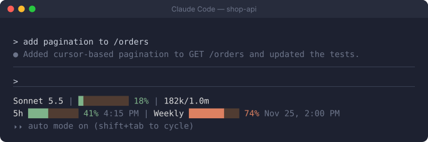
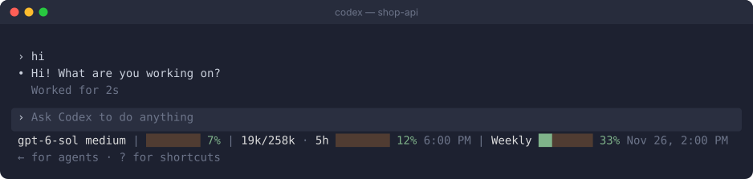
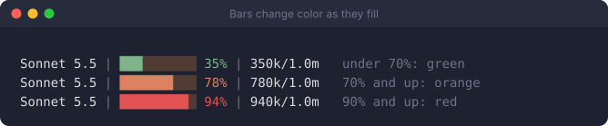
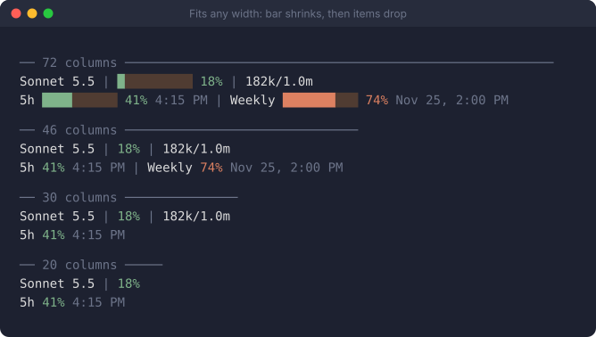
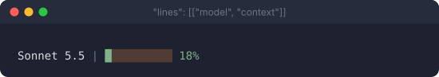
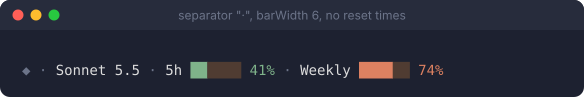
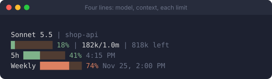

<p align="center">
  
</p>

<h1 align="center">AI Headroom</h1>

<p align="center">
  <b>รู้ว่า AI ของคุณเหลือที่อีกเท่าไหร่ ตรงบรรทัดล่างสุดของเทอร์มินัล</b>
</p>

<p align="center">
  
  
  
  
  
</p>

<p align="center">
  <a href="#ทำอะไรได้">ทำอะไรได้</a> ·
  <a href="#วิธีติดตั้ง">วิธีติดตั้ง</a> ·
  <a href="#หน้าตาเป็นยังไง">หน้าตา</a> ·
  <a href="#ปรับแต่ง">ปรับแต่ง</a> ·
  <a href="#ความเป็นส่วนตัว">ความเป็นส่วนตัว</a> ·
  <a href="#แก้ปัญหา">แก้ปัญหา</a> ·
  <a href="README.md">English</a>
</p>

<p align="center">
  
  <br>
  <sub>สร้างจากโค้ดจัด layout ตัวจริง · ข้อมูลตัวอย่าง</sub>
</p>

---

## ทำอะไรได้

คุณกำลังให้ Claude Code หรือ Codex แก้โค้ดชิ้นใหญ่ คำตอบเริ่มมั่วขึ้นเรื่อยๆ แล้วมันก็หยุดไป เพราะ context เต็ม หรือโควตา 5 ชั่วโมงหมด โดยที่คุณไม่รู้มาก่อนเลยว่าใกล้แล้ว

**AI Headroom เอาตัวเลขที่คุณต้องคอยเช็กมาไว้ในแถบสถานะของ AI CLI** อัปเดตไปพร้อมกับที่คุณทำงาน คุณจะเห็นก่อนที่จะชนกำแพง

- **โมเดลและ context:** โมเดลที่ใช้อยู่ แถบ context window และจำนวน token เช่น `182k/1.0m`
- **โควตา:** โควตา 5 ชั่วโมงและรายสัปดาห์ พร้อมเวลาที่จะรีเซ็ต
- **สีบอกระดับ:** เขียวเมื่อต่ำกว่า 70% ส้มตั้งแต่ 70% แดงตั้งแต่ 90%
- **จัดวางเองได้:** เลือกว่าแต่ละบรรทัดมีอะไรและเรียงแบบไหน แยกของ Claude กับ Codex ได้
- **ไม่พังเวลาย่อจอ:** แถบจะหดก่อน แล้วรายการท้ายบรรทัดค่อยหายไป บรรทัดจึงไม่ขึ้นใหม่จนเละ
- **อยู่ร่วมกับเครื่องมืออื่นได้:** `--wrap` เก็บ status line เดิมของคุณไว้ เช่น [AFK Pug](https://github.com/Pug-03/AFK_Pug) และตอนถอดออกจะคืนค่าเดิมให้ครบ
- **ไม่แต่งตัวเลขเอง:** ถ้า CLI ไม่ได้ส่งค่าโควตามา AI Headroom จะไม่แสดง แทนที่จะเดา
- **อยู่แค่ในเครื่องคุณ:** ไม่ต้องมีบัญชี ไม่มี telemetry ไม่ต่อเน็ตถ้าคุณไม่เปิดเอง

| ใช้กับ | เชื่อมต่อยังไง | จำนวนบรรทัด |
|---|---|---|
| **Claude Code** | คำสั่ง `statusLine` ใน `~/.claude/settings.json` | กี่บรรทัดก็ได้ |
| **OpenAI Codex CLI** | ระบบ status line provider ของ Codex เอง (MCP) | แถวเดียว ([ทำไม](#ทำไม-codex-มีแค่แถวเดียว)) |
| **CLI อื่นๆ** | `aiheadroom watch` ในแผง tmux หรือแท็บข้างๆ | กี่บรรทัดก็ได้ |

---

## วิธีติดตั้ง

ใช้เวลาประมาณ 2 นาที ส่วนใหญ่ทำแค่ **ก่อนเริ่ม**, **A** แล้วต่อด้วย **B** หรือ **C**

| ส่วน | ทำอะไร | ใครต้องทำ |
|---|---|---|
| [ก่อนเริ่ม](#ก่อนเริ่ม) | เช็ก Node.js | ทุกคน |
| [A. ติดตั้งคำสั่ง](#a-ติดตั้งคำสั่ง) | พิมพ์บรรทัดเดียวใน Terminal | ทุกคน |
| [B. Claude Code](#b-claude-code) | เปิดแถบสถานะ | คนใช้ Claude Code |
| [C. Codex CLI](#c-codex-cli) | ลงทะเบียนแล้วเลือก provider | คนใช้ Codex |
| [D. CLI อื่นและ tmux](#d-cli-อื่นและ-tmux) | เปิดหน้าต่างแสดงผลไว้ข้างๆ | ไม่บังคับ |
| [อัปเดตหรือถอดออก](#อัปเดตหรือถอดออก) | เวอร์ชันใหม่ หรือเลิกใช้ | ทีหลัง |

### ก่อนเริ่ม

ต้องมี **Node.js 22.18 ขึ้นไป** เช็กได้ใน Terminal:

```sh
node --version
```

ถ้าเวอร์ชันเก่ากว่านี้หรือยังไม่มี ติดตั้งจาก [nodejs.org](https://nodejs.org) หรือ `brew install node`

### A. ติดตั้งคำสั่ง

```sh
npm install -g https://github.com/Pug-03/AI-Headroom/archive/refs/heads/main.tar.gz
aiheadroom doctor
```

`doctor` จะเช็ก Node, หา Claude Code กับ Codex และบอกว่าการตั้งค่าตรงไหนผิด

<details>
<summary><b>อยากใช้ตัวติดตั้งบรรทัดเดียว หรือ build เองจากซอร์สโค้ด</b></summary>
<br>

ตัวติดตั้งทำขั้น A และ B ให้เลย:

```sh
curl -fsSL https://raw.githubusercontent.com/Pug-03/AI-Headroom/main/install.sh | sh
```

build จากซอร์สโค้ด:

```sh
git clone https://github.com/Pug-03/AI-Headroom.git
cd AI-Headroom
npm install        # build ให้ด้วย
npm link           # ให้พิมพ์ aiheadroom ได้จากทุกที่
```

</details>

### B. Claude Code

**B1. ดูก่อนว่าจะเปลี่ยนอะไร** ขั้นนี้ยังไม่แก้ไฟล์ใดๆ:

```sh
aiheadroom install --claude --wrap --dry-run
```

**B2. ติดตั้ง**

```sh
aiheadroom install --claude --wrap
```

| ตัวเลือก | status line เดิมของคุณจะเป็นยังไง |
|---|---|
| `--wrap` | **เก็บไว้ข้างหน้า** ยังได้รับข้อมูลจาก Claude เหมือนเดิม (AFK Pug ยังติดตามโควตาได้) ส่วน AI Headroom เป็นคนวาดแถบ |
| `--force` | ถูกแทนที่ด้วย AI Headroom |
| ไม่ใส่ทั้งสองอย่าง | ถ้ามี status line อยู่แล้ว จะไม่เปลี่ยนอะไร และให้คุณเลือกก่อน |

ทั้งสองแบบสำรอง `settings.json` ไว้ก่อนเสมอ เป็นไฟล์ `settings.json.aiheadroom-backup-<เวลา>`

**B3. รีสตาร์ท Claude Code** แถบใหม่จะขึ้นใต้ช่องพิมพ์

### C. Codex CLI

**C1. ลงทะเบียน AI Headroom กับ Codex**

```sh
aiheadroom install --codex
```

คำสั่งนี้รัน `codex mcp add aiheadroom …` ให้

**C2. เปิดฟีเจอร์ custom status line** เปิด `codex` แล้วพิมพ์ `/experimental` กด <kbd>space</kbd> ติ๊ก **Custom status line** กด <kbd>enter</kbd> แล้วปิดและเปิด Codex ใหม่

**C3. เลือก provider** ส่งข้อความอะไรก็ได้หนึ่งครั้ง แล้วพิมพ์ `/statusline` → **Choose a status line provider** → **AI Headroom**

ทำครั้งเดียวพอ Codex จะจำไว้

> [!NOTE]
> ระบบ status line provider ยังเป็นฟีเจอร์ทดลองของ Codex ถ้าวันหนึ่งฟุตเตอร์กลับเป็นแบบเดิม ดู [ฟุตเตอร์ของ Codex กลับเป็นแบบเดิม](#ฟุตเตอร์ของ-codex-กลับเป็นแบบเดิม)

### D. CLI อื่นและ tmux

ถ้า CLI ตัวไหนไม่มีที่ให้ใส่แถบสถานะ ให้เปิด AI Headroom ไว้ข้างๆ มันจะวาดใหม่ทุก 2 วินาทีจาก session log ของ Codex ในเครื่อง:

```sh
aiheadroom watch --provider codex
```

ตัวเลขที่อ่านจาก log ไม่ได้มาจาก CLI โดยตรง จะมี `~` นำหน้า

### อัปเดตหรือถอดออก

| ต้องการ | พิมพ์ |
|---|---|
| **อัปเดต** | `npm install -g https://github.com/Pug-03/AI-Headroom/archive/refs/heads/main.tar.gz` อีกครั้ง แล้วรีสตาร์ท CLI |
| **ถอดออกจาก Claude Code และ Codex** | `aiheadroom uninstall` (คืน status line เดิมของ Claude ให้) |
| **ลบคำสั่งออก** | `npm uninstall -g aiheadroom` |

---

## หน้าตาเป็นยังไง

### Claude Code

<p align="center">
  
</p>

ค่าเริ่มต้นมีสองบรรทัด บรรทัดบนเป็น **โมเดล · แถบ context · token** บรรทัดล่างเป็น **โควตา 5 ชั่วโมงและรายสัปดาห์ พร้อมเวลารีเซ็ต**

### Codex CLI

<p align="center">
  
</p>

ข้อมูลชุดเดียวกัน อยู่ในฟุตเตอร์ของ Codex แถวเดียว

### ความหมายของสี

<p align="center">
  
</p>

| สี | เมื่อไหร่ | ควรทำอะไร |
|---|---|---|
| 🟩 เขียว | ต่ำกว่า 70% | ทำต่อได้เลย |
| 🟧 ส้ม | ตั้งแต่ 70% | เตรียมปิดงาน หรือเริ่ม session ใหม่เร็วๆ นี้ |
| 🟥 แดง | ตั้งแต่ 90% | AI อาจหยุดหรือย่อ context ได้ทุกเมื่อ |

### จอแคบ

<p align="center">
  
</p>

พอหน้าต่างแคบลง แถบจะหดก่อน แล้วรายการท้ายบรรทัดค่อยหายไป

---

## ปรับแต่ง

สร้างไฟล์ตั้งค่า ดูว่าใส่อะไรได้บ้าง แล้วลองดูหน้าตาด้วยข้อมูลตัวอย่าง:

```sh
aiheadroom config init     # สร้าง ~/.config/aiheadroom/config.json
aiheadroom items           # ดูรายการทั้งหมดที่ใส่ได้
aiheadroom preview         # หน้าตาใน Claude
aiheadroom preview --provider codex
```

ใน `lines` หนึ่ง `[ … ]` คือหนึ่งบรรทัด เรียงจากบนลงล่าง ของข้างในเรียงจากซ้ายไปขวา

```json
{
  "lines": [
    ["model", "context", "tokens"],
    ["limit-5h", "limit-weekly"]
  ],
  "providers": {
    "codex": {
      "lines": [["model", "context", "tokens", "limit-5h", "limit-weekly"]],
      "separator": "·",
      "barWidth": 6,
      "showResets": false
    }
  }
}
```

แก้แล้ว Codex จะเห็นผลภายในประมาณ 1 วินาที ส่วน Claude Code จะเห็นตอนแถบรีเฟรชครั้งถัดไป

<table>
<tr>
<td width="50%"><br><b>แบบเรียบ</b><br><code>[["model", "context"]]</code></td>
<td width="50%"><br><b>แบบกะทัดรัด</b><br><code>"separator": "·", "barWidth": 6, "showResets": false</code></td>
</tr>
<tr>
<td colspan="2"><br><b>แบบละเอียด</b><br><code>[["model", "cwd"], ["context", "tokens", "remaining"], ["limit-5h"], ["limit-weekly"]]</code></td>
</tr>
</table>

### รายการที่ใส่ได้

| รายการ | แสดง | ตัวอย่าง |
|---|---|---|
| `model` | ชื่อโมเดล | `Sonnet 5.5` |
| `context` | แถบ context และเปอร์เซ็นต์ | `███░░░░░░░ 18%` |
| `tokens` | token ที่ใช้ / ทั้งหมด | `182k/1.0m` |
| `remaining` | token ที่เหลือ | `818k left` |
| `limit-5h` | โควตา 5 ชั่วโมงและเวลารีเซ็ต | `5h ████░░ 41% 4:15 PM` |
| `limit-weekly` | โควตารายสัปดาห์และเวลารีเซ็ต | `Weekly ███████░ 74% Nov 25` |
| `limits` | โควตาทุกตัวที่ CLI ส่งมา | |
| `cwd` | ชื่อโฟลเดอร์ | `shop-api` |
| `provider` | CLI ตัวไหน | `claude` |
| `text:…` | ข้อความที่พิมพ์เอง | `text:🐶` |

### การตั้งค่า

| ค่า | ทำอะไร | ค่าเริ่มต้น |
|---|---|---|
| `lines` | แต่ละบรรทัดแสดงอะไร ได้สูงสุด 4 บรรทัด บรรทัดละ 12 รายการ | model, context, tokens / 5h, weekly |
| `separator` | ตัวคั่นระหว่างรายการ ไม่เกิน 3 ตัวอักษร ใส่ `""` จะได้ช่องว่าง | `\|` |
| `barWidth` | ความยาวแถบ 0–40 ช่อง (ใส่ 0 จะไม่มีแถบ) | `10` |
| `showResets` | แสดงเวลารีเซ็ตต่อท้ายแถบโควตา | `true` |
| `providers.claude` / `providers.codex` | ตั้งค่าใดก็ได้ข้างบน แยกเฉพาะ CLI ตัวนั้น | |
| `claude.oauthUsage` | ดึงโควตาของ Claude ผ่าน usage API เมื่อ Claude ไม่ได้ส่งมา ([รายละเอียด](#ความเป็นส่วนตัว)) | `false` |

| ตัวแปร environment | ผล |
|---|---|
| `NO_COLOR=1` | ไม่มีสี เป็นตัวหนังสือธรรมดา |
| `COLUMNS=80` หรือ `--columns 80` | ความกว้างที่ต้องจัดให้พอดี |
| `AIHEADROOM_CLAUDE_OAUTH=1` หรือ `--oauth-usage` | เหมือน `claude.oauthUsage` |

ใส่ค่าผิดก็ไม่พัง AI Headroom จะใช้ค่าเริ่มต้นแทน และ `aiheadroom doctor` จะบอกว่าต้องแก้ตรงไหน

---

## ความเป็นส่วนตัว

- **ไม่มี telemetry และไม่ต้องมีบัญชี**
- **ปกติไม่ต่อเน็ตเลย** Claude Code และ Codex ส่งข้อมูลให้ AI Headroom โดยตรง
- **usage API ของ Claude ต้องเปิดเอง** ถ้าเปิด `claude.oauthUsage` และ Claude ไม่ได้ส่งค่าโควตามา AI Headroom จะใช้ token ที่ Claude Code เก็บไว้แล้ว (จาก environment variable หรือ Keychain ของ macOS) ไปถาม `api.anthropic.com` ไม่เกินนาทีละครั้ง endpoint นี้ไม่มีเอกสารทางการและอาจเปลี่ยนได้
- **Codex:** อ่านแค่ `~/.codex/sessions/` และบรรทัด `model` ใน `~/.codex/config.toml` ไม่เปิดไฟล์ล็อกอินของ Codex เด็ดขาด มีเทสต์คอยตรวจโค้ด
- **การตั้งค่าของคุณถูกสำรองไว้** ก่อนแก้ทุกครั้ง และ `aiheadroom uninstall` คืนค่าเดิมให้

---

## แก้ปัญหา

### ฟุตเตอร์ของ Codex กลับเป็นแบบเดิม

ถ้าอ่านข้อมูลพลาดครั้งเดียว Codex จะหยุดถาม provider แล้วกลับไปใช้ฟุตเตอร์เดิม กด <kbd>F2</kbd> เพื่อดูสาเหตุ แล้วพิมพ์ `/statusline` → **Choose a status line provider** → **AI Headroom** เพื่อเริ่มใหม่ หลังอัปเดต AI Headroom ให้รีสตาร์ท Codex ด้วย จะได้ใช้เวอร์ชันใหม่

### ทำไม Codex มีแค่แถวเดียว

ฟุตเตอร์ของ Codex ไม่มีการขึ้นบรรทัดใหม่ และไม่รับตัวอักษรควบคุมอย่าง `\n` AI Headroom จึงต่อบรรทัดด้วย `·` แทน ถ้ายาวเกินหน้าต่าง Codex จะตัดขึ้นบรรทัดให้เอง ถ้าต้องการหลายบรรทัด ใช้ Claude Code หรือ `aiheadroom watch`

<details>
<summary><b>ไม่เห็นโควตา</b></summary>
<br>

AI Headroom แสดงเฉพาะโควตาที่ CLI ส่งมา จะไม่เห็นถ้ายังไม่ได้ล็อกอิน แพ็กเกจไม่มีโควตา หรือใน Codex ก่อนได้คำตอบแรกของ session สำหรับ Claude เปิดการดึงผ่าน usage API ได้ด้วย `"claude": { "oauthUsage": true }`

</details>

<details>
<summary><b>Claude Code ยังแสดงแถบแบบเดิม</b></summary>
<br>

รีสตาร์ท Claude Code แล้วเช็กว่าตั้งค่าอะไรไว้:

```sh
aiheadroom doctor
grep -A3 statusLine ~/.claude/settings.json
```

ถ้ามีแอปอื่นมาเขียน `statusLine` ทับ ให้รัน `aiheadroom install --claude --wrap` อีกครั้ง

</details>

<details>
<summary><b>ขึ้นว่า <code>aiheadroom: command not found</code></b></summary>
<br>

โฟลเดอร์ global ของ npm ไม่ได้อยู่ใน `PATH` หาตำแหน่งด้วย `npm prefix -g` แล้วเพิ่มโฟลเดอร์ `bin` ข้างในเข้าไปใน `PATH` จากนั้นเปิดหน้าต่าง Terminal ใหม่

</details>

<details>
<summary><b>Codex ไม่มี AI Headroom ให้เลือก</b></summary>
<br>

เช็กว่าลงทะเบียนแล้วด้วย `codex mcp list`, เปิด **Custom status line** ใน `/experimental` แล้ว และส่งข้อความใน session นี้อย่างน้อยหนึ่งครั้ง เพราะ provider จะเชื่อมต่อตอนเริ่มบทสนทนา

</details>

---

## สำหรับนักพัฒนา

```
adapters/*  →  Snapshot  →  core/layout  →  render/ansi        (Claude Code, watch)
(CLI ละตัว)    (กลาง)       (แถบ, จัดความกว้าง)  render/codexTree    (ฟุตเตอร์ Codex)
```

CLI แต่ละตัวมี adapter ที่แปลงข้อมูลเป็น `Snapshot` กลางแบบเดียวกัน ส่วนจัดวางและวาดไม่รู้จัก CLI ตัวไหนเลย การรองรับ CLI ใหม่จึงเพิ่มแค่ไฟล์เดียว ดู [Adding an adapter](docs/ADDING_AN_ADAPTER.md)

```sh
npm install
npm run typecheck
npm test
npm run images     # สร้างรูปใน site/assets ใหม่
```

`site/` เป็นหน้าเว็บ static สลับไทย/อังกฤษได้ เปิด `site/index.html` ได้เลย หรือเผยแพร่ด้วย GitHub Pages

## License

MIT
